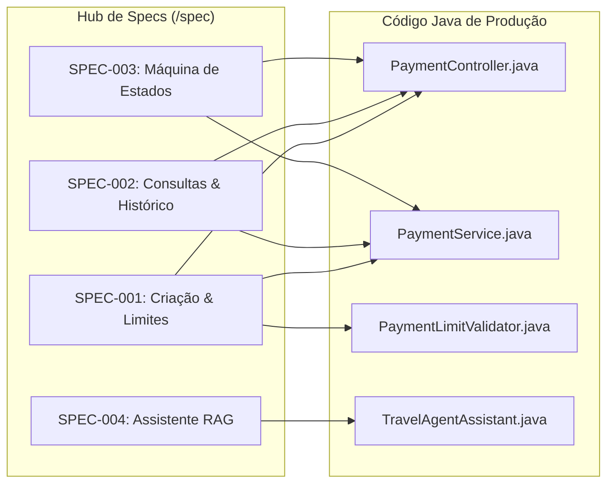

# 📘 Curso Completo de Spec-Driven Development (SDD): Do Zero ao Avançado
> **A Bíblia da Engenharia de Software Orientada por Especificações Vivas, Agentes de IA e Harness Engineering**  
> *Baseado no ecossistema real do microsserviço [Payment System](file:///home/diegosneves/Github/pessoal/java/payment-system/README.md), nos artefatos da pasta [`spec/`](file:///home/diegosneves/Github/pessoal/java/payment-system/spec/) e nas melhores práticas da indústria (SoftDesign, GitHub Spec-Kit, Tessl e Kiro).*

---

## 📑 Índice Geral

1. [Módulo 1: Fundamentos de SDD e a Mudança de Paradigma](#módulo-1-fundamentos-de-sdd-e-a-mudança-de-paradigma)
   - 1.1 [O que é Spec-Driven Development?](#11-o-que-é-spec-driven-development)
   - 1.2 [O Problema do Modelo Tradicional (Code-Driven)](#12-o-problema-do-modelo-tradicional-code-driven)
   - 1.3 [A Armadilha do "Waterfall Automatizado" e do "Vibe Coding Sem Trilhos"](#13-a-armadilha-do-waterfall-automatizado-e-do-vibe-coding-sem-trilhos)
   - 1.4 [Tabela Comparativa Definitiva: Code-Driven vs TDD vs BDD vs SDD](#14-tabela-comparativa-definitiva)
   - 1.5 [O Modelo de Maturidade em SDD (Spec Maturity Model - 5 Níveis)](#15-o-modelo-de-maturidade-em-sdd)
2. [Módulo 2: Desconstrução Detalhada da Pasta `spec/` do Projeto](#módulo-2-desconstrução-detalhada-da-pasta-spec-do-projeto)
   - 2.1 [O Hub e Matriz de Rastreabilidade (`spec/README.md`)](#21-o-hub-e-matriz-de-rastreabilidade-specreadmemd)
   - 2.2 [A Anatomia de uma Especificação Viva (`spec/TEMPLATE.md`)](#22-a-anatomia-de-uma-especificação-viva-spectemplatemd)
   - 2.3 [Criação e Controle Financeiro de Limites (`spec/SPEC-001`)](#23-criação-e-controle-financeiro-de-limites-spec-001)
   - 2.4 [Consultas, UUID e Contratos Defensivos (`spec/SPEC-002`)](#24-consultas-uuid-e-contratos-defensivos-spec-002)
   - 2.5 [Máquina de Estados e Invariantes Críticas (`spec/SPEC-003`)](#25-máquina-de-estados-e-invariantes-críticas-spec-003)
   - 2.6 [Assistente de Viagens com IA e RAG Local (`spec/SPEC-004`)](#26-assistente-de-viagens-com-ia-e-rag-local-spec-004)
   - 2.7 [Harness Engineering e a Grade de Proteção (`spec/HARNESS.md`)](#27-harness-engineering-e-a-grade-de-proteção-specharnessmd)
3. [Módulo 3: O Ecossistema de Ferramentas — Spec-Kit, OpenAPI e Plataformas Agênticas](#módulo-3-o-ecossistema-de-ferramentas)
   - 3.1 [GitHub Spec-Kit (`github/spec-kit` / CLI `specify`)](#31-github-spec-kit)
   - 3.2 [Revisão do Termo "OpenCloud" e o Ecossistema Real de Contratos (OpenAPI & Cloud Native)](#32-revisão-do-termo-opencloud)
   - 3.3 [Plataformas Agênticas Emergentes (Tessl, Kiro e Product Dock)](#33-plataformas-agênticas-emergentes)
4. [Módulo 4: Passo a Passo — Como Adicionar um Novo Recurso no Projeto](#módulo-4-passo-a-passo-como-adicionar-um-novo-recurso)
   - Caso Real: Adicionando o Recurso de Estorno / Reembolso de Pagamento (`SPEC-005`)
5. [Módulo 5: Passo a Passo — Como Modificar um Recurso Existente com Segurança](#módulo-5-passo-a-passo-como-modificar-um-recurso-existente)
   - Caso Real: Aumentando o Teto Diário para R$ 5.000 e Adicionando `CRYPTOCURRENCY`
6. [Módulo 6: Passo a Passo — Como Criar um Projeto do Absoluto Zero com SDD e Spec-Kit](#módulo-6-passo-a-passo-como-criar-um-projeto-do-absoluto-zero)
7. [Conclusão: O Papel do Desenvolvedor na Era dos Agentes de IA](#conclusão-o-papel-do-desenvolvedor-na-era-dos-agentes-de-ia)

---

# Módulo 1: Fundamentos de SDD e a Mudança de Paradigma

## 1.1 O que é Spec-Driven Development?

O **Spec-Driven Development (SDD)** é uma metodologia de engenharia de software onde **especificações estruturadas, versionadas e interpretáveis por máquinas e humanos atuam como a fonte primária e inegociável da verdade** durante todo o ciclo de vida do software (*SDLC*).

No modelo mental do SDD:
- A especificação deixa de ser um documento estático (Word, Confluence ou card de Jira) esquecido após a primeira sprint.
- A especificação torna-se um **artefato executável e vivo** que reside no mesmo repositório do código.
- A IA generativa e copilotos avançados utilizam a especificação como **input determinístico** para gerar scaffolding, regras de negócio, contratos de API e testes automatizados.

```
                    ┌─────────────────────────────────────────────────────────┐
                    │               FLUXO SPEC-DRIVEN (SDD)                   │
                    └─────────────────────────────────────────────────────────┘
                                                 │
                                                 ▼
                    ┌─────────────────────────────────────────────────────────┐
                    │      Intenção de Negócio Formalizada (/spec/*.md)       │
                    │  - Contratos OpenAPI / Schemas JSON / Records           │
                    │  - Regras de Negócio Invariantes                        │
                    │  - Critérios de Aceitação BDD (Given-When-Then)         │
                    └────────────────────┬───────────────────┬────────────────┘
                                         │                   │
                                         ▼                   ▼
                      ┌──────────────────────┐   ┌───────────────────────────┐
                      │    Geração de Testes │   │    Geração de Código      │
                      │    (Test Harness)    │   │    (Models, DTOs, APIs)   │
                      └──────────┬───────────┘   └─────────────┬─────────────┘
                                 │                             │
                                 └──────────────┬──────────────┘
                                                ▼
                                 ┌───────────────────────────┐
                                 │  Execução do Test Harness │
                                 │     (Validação Rígida)    │
                                 └──────────────┬────────────┘
                                                ▼
                                    Deploy Seguro em Produção
```

---

## 1.2 O Problema do Modelo Tradicional (Code-Driven)

Durante décadas, a indústria operou no modelo **Code-Driven** (Orientado a Código):
1. Alguém escreve um requisito vago ou informal.
2. O desenvolvedor interpreta o requisito mentalmente e programa o código.
3. O código passa a ser a **única fonte real da verdade**.
4. Qualquer documentação prévia torna-se instantaneamente obsoleta.

### As Consequências do Code-Driven:
- **Silos de Conhecimento:** As regras de negócio reais ficam na cabeça de poucos desenvolvedores ou escondidas em milhares de linhas de código espaguete.
- **Retrabalho Crônico:** Como a intenção nunca foi formalizada sem ambiguidades, o código gerado frequentemente não atende à expectativa do cliente.
- **Medo de Refatoração:** Alterar uma funcionalidade antiga vira uma roleta-russa, pois ninguém sabe quais efeitos colaterais estão implícitos no código legado.

---

## 1.3 A Armadilha do "Waterfall Automatizado" e do "Vibe Coding Sem Trilhos"

Com a popularização de ferramentas de IA generativa (ChatGPT, Claude Code, Copilot, Gemini CLI), muitos times caíram em duas armadilhas perigosas:

### Armadilha 1: "Vibe Coding" sem Trilhos
O desenvolvedor faz prompts soltos em linguagem natural sem qualquer arquitetura prévia. A IA cospe código rapidamente. Nos primeiros 3 dias tudo parece veloz, mas em 2 semanas o projeto é um monstro inauditável, com duplicações, vulnerabilidades de segurança e débito técnico terminal.

### Armadilha 2: O "Waterfall Automatizado"
O time escreve uma especificação bonita no primeiro dia. A IA gera o código. Quando um novo requisito surge na semana seguinte, o desenvolvedor altera **diretamente o arquivo `.java`** e abandona a especificação no repositório. Em poucas sprints, a especificação mente e o time volta à estaca zero do modelo tradicional.

> ⚠️ **A REGRA DE OURO DO SDD:**  
> **Se o comportamento do sistema mudar, o Pull Request DEVE alterar primeiro ou simultaneamente a especificação em `/spec`. Nenhuma mudança de comportamento de software entra em produção sem atualização correspondente da sua especificação viva.**

---

## 1.4 Tabela Comparativa Definitiva

| Dimensão | Code-Driven Tradicional | TDD (Test-Driven Development) | BDD (Behavior-Driven Development) | SDD (Spec-Driven Development) |
| :--- | :--- | :--- | :--- | :--- |
| **Fonte Central da Verdade** | Código-fonte (`.java`) | Suíte de Testes Unitários | Cenários em Linguagem Ubíqua (Gherkin) | **Especificações Vivas Estruturadas (`/spec/*.md`)** |
| **Foco Primário** | Implementação técnica e sintaxe | Design de software e ausência de bugs de baixo nível | Comunicação e alinhamento de comportamento com o negócio | **Intenção do Produto + Contratos Rigorosos + Geração Agêntica** |
| **Papel da IA** | Autocompletar código ad-hoc | Escrever testes e classes isoladas | Gerar cenários de step-definitions | **Orquestração completa: a IA deriva código e testes a partir da spec** |
| **Papel do Desenvolvedor** | Escrever sintaxe manualmente | Escrever testes vermelhos -> código verde -> refatorar | Facilitar reuniões de "Três Amigos" | **Arquiteto de Intenção, Projetista de Contratos e Validador do Harness** |
| **Mecanismo de Validação** | Teste manual / QA tardio | Testes automatizados rápidos | Cucumber / SpecFlow | **Harness Engineering (Testcontainers, MockMvc, linters e CI/CD)** |
| **Resistência à Obsolescência** | Quase nula (documentação morre cedo) | Baixa a nível de negócio (testes unitários não explicam o produto) | Média (depende da manutenção dos arquivos `.feature`) | **Máxima (o código é derivado ou ancorado na especificação)** |

---

## 1.5 O Modelo de Maturidade em SDD (Spec Maturity Model)

A adoção do SDD não ocorre da noite para o dia. As organizações progridem em uma escala de maturidade de 5 níveis:

```
┌────────────────────────────────────────────────────────────────────────┐
│ NÍVEL 5: Organização Orientada por Intenção (Fronteira Agêntica)       │
│          Agentes autônomos geram, corrigem (self-healing) e mantêm PRs │
├────────────────────────────────────────────────────────────────────────┤
│ NÍVEL 4: Specs Executáveis & Código Compilado da Spec                  │
│          Frameworks como Tessl/Kiro derivam serviços completos da spec │
├────────────────────────────────────────────────────────────────────────┤
│ NÍVEL 3: Spec-Anchored com Test Harness Integrado (ESTADO ATUAL)       │
│          Specs coexistem no Git, com testes reais (Testcontainers)     │
├────────────────────────────────────────────────────────────────────────┤
│ NÍVEL 2: Specs Estruturadas via IA                                     │
│          Templates ricos em Markdown eliminam ruídos e ambiguidades    │
├────────────────────────────────────────────────────────────────────────┤
│ NÍVEL 1: Documentação Estática Desconectada                            │
│          Requisitos no Confluence/Jira totalmente dissociados do código│
└────────────────────────────────────────────────────────────────────────┘
```

O projeto `payment-system` encontra-se consolidado no **Nível 3/4**: suas especificações estão ancoradas no mesmo repositório do código Java e são 100% validadas pelo seu **Test Harness**.

---

# Módulo 2: Desconstrução Detalhada da Pasta `spec/` do Projeto

Vamos agora analisar cirurgicamente cada arquivo contido na pasta [`spec/`](file:///home/diegosneves/Github/pessoal/java/payment-system/spec/), demonstrando como os conceitos abstratos se materializam em código Java de produção.

---

## 2.1 O Hub e Matriz de Rastreabilidade (`spec/README.md`)

O arquivo [`spec/README.md`](file:///home/diegosneves/Github/pessoal/java/payment-system/spec/README.md) funciona como a porta de entrada de qualquer engenheiro ou agente de IA que chegue ao projeto.

### Funções Principais:
1. **Índice Unificado:** Lista todas as especificações ativas e seus status (`Draft`, `Under Review`, `Approved`, `Implemented`).
2. **Matriz de Rastreabilidade Bidirecional:** Conecta cada especificação (`SPEC-XXX`) aos arquivos Java do `src/main` e aos arquivos de teste do `src/test`.
3. **Diagrama de Dependências:** Demonstra visualmente (via Mermaid) como o domínio de pagamentos se divide em subsistemas.



---

## 2.2 A Anatomia de uma Especificação Viva (`spec/TEMPLATE.md`)

O arquivo [`spec/TEMPLATE.md`](file:///home/diegosneves/Github/pessoal/java/payment-system/spec/TEMPLATE.md) define o padrão estrutural obrigatório para qualquer funcionalidade. Vamos dissecar as suas 5 seções vitais:

```
┌────────────────────────────────────────────────────────┐
│ 1. Cabeçalho de Governança (ID, Versão, Squad, Status) │
├────────────────────────────────────────────────────────┤
│ 2. Intenção & Contexto de Negócio                      │
├────────────────────────────────────────────────────────┤
│ 3. Contratos Técnicos (OpenAPI, JSON Schema, Records)  │
├────────────────────────────────────────────────────────┤
│ 4. Regras de Negócio Invariantes (RN-01, RN-02, ...)   │
├────────────────────────────────────────────────────────┤
│ 5. Critérios de Aceitação BDD (Given-When-Then)        │
└────────────────────────────────────────────────────────┘
```

### Por que essa estrutura é cirúrgica para IAs?
- **O cabeçalho** impede que IAs alterem artefatos depreciados ou fora da versão semântica correta.
- **A intenção** dá o contexto de alto nível (evita alucinações de escopo).
- **Os contratos** definem a assinatura matemática de entrada e saída.
- **As regras de negócio** definem a lógica determinística.
- **Os critérios de aceite** são convertidos diretamente em métodos de teste `@Test`.

---

## 2.3 Criação e Controle Financeiro de Limites (`spec/SPEC-001`)

O arquivo [`spec/SPEC-001-payment-creation-and-limits.md`](file:///home/diegosneves/Github/pessoal/java/payment-system/spec/SPEC-001-payment-creation-and-limits.md) documenta a criação de novos pagamentos.

### A Regra de Negócio Crucial: RN-03 (Teto Diário de R$ 2.000,00)
A regra diz:
> Cada pagador tem um limite máximo de **R\$ 2.000,00** por dia civil no fuso de São Paulo. Se a soma dos pagamentos do dia mais o novo valor ultrapassar R$ 2.000,00, a transação deve ser rejeitada com HTTP 422.

### Como a Spec Especificou:
```markdown
### Cenário 3: Rejeição ao ultrapassar o teto diário cumulativo
- **Dado que** o pagador possui R$ 1.901,00 em pagamentos no dia de hoje,
- **Quando** enviar uma requisição POST /api/payments com amount=100.00 via PIX,
- **Então** o sistema não deve persistir o novo pagamento,
- **E** deve retornar HTTP 422 Unprocessable Entity com a mensagem "Daily payment limit exceeded for source: PIX".
```

### Como Isso se Concretizou no Código Java:
1. **No Validador Puro ([`PaymentLimitValidator.java`](file:///home/diegosneves/Github/pessoal/java/payment-system/src/main/java/br/com/neves/paymentsystem/validators/PaymentLimitValidator.java)):**
   ```java
   public static final BigDecimal MAX_PAYMENT_LIMIT = new BigDecimal("2000.00");

   public static Boolean isWithinLimit(final BigDecimal amount) throws PaymentLimitException {
       Boolean result = Boolean.FALSE;
       if (amount != null) {
           validateAmount(amount);
           result = amount.compareTo(MAX_PAYMENT_LIMIT) <= 0;
       }
       return result;
   }
   ```

2. **Na Regra de Consulta do Repositório ([`PaymentRepository.java`](file:///home/diegosneves/Github/pessoal/java/payment-system/src/main/java/br/com/neves/paymentsystem/repository/PaymentRepository.java)):**
   ```java
   @Query("SELECT COALESCE(SUM(p.amount), 0) FROM Payment p " +
          "WHERE p.payerId = :payerId AND p.createdAt BETWEEN :start AND :end")
   BigDecimal sumPaymentsByPayerIdAndDate(@Param("payerId") UUID payerId, 
                                         @Param("start") Instant start, 
                                         @Param("end") Instant end);
   ```

3. **No Serviço ([`PaymentService.java`](file:///home/diegosneves/Github/pessoal/java/payment-system/src/main/java/br/com/neves/paymentsystem/services/PaymentService.java)):**
   ```java
   final var newDailyTotal = dailyTotal.add(request.amount());
   if (!PaymentLimitValidator.isWithinLimit(newDailyTotal)) {
       throw PaymentLimitException.with(
           new ErrorData("Daily payment limit exceeded for source: %s".formatted(request.paymentSource()))
       );
   }
   ```

4. **No Teste do Harness ([`PaymentServiceTest.java`](file:///home/diegosneves/Github/pessoal/java/payment-system/src/test/java/br/com/neves/paymentsystem/services/PaymentServiceTest.java)):**
   ```java
   @Test
   @DisplayName("Should throw exception when limit is exceeded")
   void shouldThrowExceptionWhenLimitIsExceeded() {
       final var request = Fixture.PaymentRequests.createPixRequest();
       when(this.repository.sumPaymentsByPayerIdAndDate(any(), any(), any()))
           .thenReturn(new BigDecimal("1901.00"));

       assertThatThrownBy(() -> this.service.createPayment(request))
           .isInstanceOf(PaymentLimitException.class)
           .hasMessageContaining("Daily payment limit exceeded for source");
   }
   ```
Observe a perfeita simetria: a linha da spec virou o teste, e o teste garantiu o código.

---

## 2.4 Consultas, UUID e Contratos Defensivos (`spec/SPEC-002`)

O arquivo [`spec/SPEC-002-payment-queries-and-history.md`](file:///home/diegosneves/Github/pessoal/java/payment-system/spec/SPEC-002-payment-queries-and-history.md) rege as leituras e o histórico.

### Princípio da Especificação: Contrato Defensivo
- Consultar um ID inexistente **é uma falha de localização**: deve retornar **HTTP 404** (`PaymentNotFoundException`).
- Consultar por um UUID malformado (`"invalido-123"`) **é um erro do cliente**: deve retornar **HTTP 400 Bad Request** (`PaymentException`).
- Consultar pagamentos de um pagador válido que nunca realizou transações **NÃO é erro**: deve retornar **HTTP 200 OK com array vazio `[]`**.

Isso evita que frontends quebrem por receberem `null` ou `404` em buscas de listas legítimas.

---

## 2.5 Máquina de Estados e Invariantes Críticas (`spec/SPEC-003`)

O arquivo [`spec/SPEC-003-payment-status-transition.md`](file:///home/diegosneves/Github/pessoal/java/payment-system/spec/SPEC-003-payment-status-transition.md) trata do ciclo de vida dos pagamentos.

### A Invariante da Máquina de Estados:
```
PENDING ───> PAID      (Permitido)
PENDING ───> FRAUD     (Permitido)
PENDING ───> PENDING   (Permitido - Idempotente)

PAID    ───> PENDING   ❌ PROIBIDO (HTTP 422 - PaymentConstraintsException)
FRAUD   ───> PENDING   ❌ PROIBIDO (HTTP 422 - PaymentConstraintsException)
```

No código Java ([`PaymentService.java:L139-L148`](file:///home/diegosneves/Github/pessoal/java/payment-system/src/main/java/br/com/neves/paymentsystem/services/PaymentService.java#L139-L148)):
```java
private static void validatePaymentStatusChange(UpdatePaymentStatusRequest request, Payment paymentFound) {
    if (!PaymentStatus.PENDING.equals(paymentFound.getStatus()) && PaymentStatus.PENDING.equals(request.status())) {
        throw PaymentConstraintsException.with(
            new ErrorData("Action not allowed for payment with status %s: %s -> %s"
                .formatted(paymentFound.getStatus().name(), request.status().name(), paymentFound.getStatus().name()))
        );
    }
}
```
A especificação garante que nenhum operador ou sistema externo consiga reverter um pagamento já aprovado para pendente, protegendo o saldo contábil.

---

## 2.6 Assistente de Viagens com IA e RAG Local (`spec/SPEC-004`)

O arquivo [`spec/SPEC-004-travel-agent-ai-rag.md`](file:///home/diegosneves/Github/pessoal/java/payment-system/spec/SPEC-004-travel-agent-ai-rag.md) demonstra como o SDD se aplica a funcionalidades modernas de IA generativa.

### Desafio da IA Generativa: Alucinação
Sem especificação, um LLM responde qualquer coisa. A `SPEC-004` estipula:
1. O uso de **LangChain4j** conectado a um modelo local via Ollama (`qwen2.5-coder:7b`).
2. Geração de embeddings com `nomic-embed-text`.
3. Ingestão estrita do documento [`src/main/resources/rag/contexto-teste.md`](file:///home/diegosneves/Github/pessoal/java/payment-system/src/main/resources/rag/contexto-teste.md).
4. **Regra de Grounding:** Quando questionado sobre Sapucaia do Sul, o assistente é proibido de inventar atrações; deve orientar o usuário a visitar Gramado ou Porto Alegre.

Dessa forma, a IA atua **dentro dos limites determinísticos definidos na especificação**.

---

## 2.7 Harness Engineering e a Grade de Proteção (`spec/HARNESS.md`)

O arquivo [`spec/HARNESS.md`](file:///home/diegosneves/Github/pessoal/java/payment-system/spec/HARNESS.md) descreve o conceito mais importante da engenharia moderna com IA: **o Harness**.

### O que é o Test Harness?
O Harness é o conjunto automatizado de verificações (Linters, Testes Unitários, Testcontainers e MockMvc) que atua como **juiz implacável**.

```
    ┌────────────────────────────────────────────────────────┐
    │                 O CICLO DE SELF-HEALING                │
    └────────────────────────────────────────────────────────┘
                                │
                                ▼
                   Agente gera/modifica código
                                │
                                ▼
                   Harness roda: `./mvnw test`
                                │
                   ┌────────────┴────────────┐
                   ▼                         ▼
             [ Teste Passou ]          [ Teste Falhou ]
                   │                         │
                   ▼                         ▼
            Pronto para PR           Harness repassa o erro
                                     + Spec de volta à IA
                                             │
                                             ▼
                                     IA reescreve código
                                             │
                                             └─────── (Loop até verde)
```

No `payment-system`, o harness utiliza **MySQL real via Testcontainers** ([`PaymentRepositoryTest.java`](file:///home/diegosneves/Github/pessoal/java/payment-system/src/test/java/br/com/neves/paymentsystem/repository/PaymentRepositoryTest.java)), garantindo que queries complexas de agregação temporal (`BETWEEN :start AND :end`) sejam testadas com 100% de fidelidade ao ambiente de produção.

---

# Módulo 3: O Ecossistema de Ferramentas — Spec-Kit, OpenAPI e Plataformas Agênticas

Nesta seção, revisamos as principais ferramentas de mercado mencionadas nos artigos e guias de SDD.

## 3.1 GitHub Spec-Kit

O **[Spec-Kit](https://github.com/github/spec-kit)** é um projeto open-source desenvolvido por engenheiros da comunidade do GitHub para transformar o desenvolvimento orientado por especificações em uma experiência prática baseada em comandos e templates padronizados.

Ele introduz o utilitário de linha de comando `specify` e convenções de slash commands projetados para agentes de IA (como GitHub Copilot Workspace, Claude Code ou Antigravity):

### Os 5 Comandos Principais do Spec-Kit:

1. **`/speckit.constitution` (A Constituição do Projeto):**
   - Estabelece as regras invioláveis de arquitetura e tecnologia do repositório.
   - Exemplo no nosso projeto: *"Usar Java 25, Spring Boot 3.5, MySQL 8, Testcontainers para testes de integração, DTOs em Java Records imutáveis e nenhuma entidade JPA exposta diretamente no controller"*.
   - A IA consulta a constituição antes de propor qualquer solução técnica.

2. **`/speckit.specify` (A Especificação do Requisito):**
   - Transforma uma ideia informal do Product Manager em uma especificação rica e estruturada (seguindo o padrão que temos no nosso `TEMPLATE.md`).
   - Define os schemas de entrada/saída, status HTTP e regras de negócio.

3. **`/speckit.plan` (O Plano de Execução Técnica):**
   - A IA decompõe a especificação em decisões arquiteturais concretas: quais classes criar, quais anotações utilizar e quais dependências adicionar no `pom.xml`.

4. **`/speckit.tasks` (Checklist de Tarefas Granulares):**
   - Gera um checklist atômico de implementação (ex: Passo 1: Criar Migration; Passo 2: Criar Record; Passo 3: Criar Teste; Passo 4: Implementar Service).

5. **`/speckit.implement` (A Execução Orientada por Tarefas):**
   - A IA executa uma tarefa por vez, rodando o compilador e os testes após cada passo, garantindo que o código nunca se desvie da especificação.

---

## 3.2 Plataformas Agênticas Emergentes (Tessl, Kiro e Product Dock)

- **[Kiro](https://kiro.dev/):** Plataforma focada em orquestrar PRDs estruturados diretamente em APIs backend funcionais, gerando endpoints e contratos.
- **[Tessl](https://tessl.io/):** Framework pioneiro em "Spec-as-Source", onde desenvolvedores passam 90% do tempo refinando especificações e a IA mantém o código de produção sincronizado.
- **Product Dock (SoftDesign):** Plataforma agêntica corporativa com Harness Engineering integrado, garantindo governança, auditoria de segurança e rastreabilidade total do discovery ao delivery.

---

# Módulo 4: Passo a Passo — Como Adicionar um Novo Recurso no Projeto

Vamos demonstrar na prática o **fluxo rigoroso de SDD** adicionando uma nova funcionalidade real: **Reembolso / Estorno de Pagamento (Refund)**.

```
       Fluxo de Adição de Feature em SDD:
       
       Passo 1: Escrever a Spec (`spec/SPEC-005-payment-refund.md`)
                            │
                            ▼
       Passo 2: Atualizar a Matriz em `spec/README.md`
                            │
                            ▼
       Passo 3: Escrever o Test Harness (Spec-to-Test)
                            │
                            ▼
       Passo 4: Gerar o Código de Produção (Implementação)
                            │
                            ▼
       Passo 5: Rodar o Harness (`./mvnw test`) e Abrir o PR
```

---

### Passo 1: Escrever a Especificação (`spec/SPEC-005-payment-refund.md`)
Copie o [`spec/TEMPLATE.md`](file:///home/diegosneves/Github/pessoal/java/payment-system/spec/TEMPLATE.md) e defina a nova funcionalidade:

```markdown
# SPEC-005: Reembolso Total de Pagamento (Refund)
- **Versão:** 1.0.0
- **Squad:** Core Banking / Payments
- **Status:** Approved

## 1. Intenção
Permitir o cancelamento e reembolso de pagamentos previamente aprovados, estornando o valor ao pagador e registrando a transição de estado.

## 2. Contratos Técnicos
- **Método HTTP:** `POST`
- **Rota:** `/api/payments/{paymentId}/refund`
- **Resposta Sucesso (HTTP 200):** `PaymentResponse` com `status="REFUNDED"`

## 3. Regras de Negócio
- **RN-01:** Apenas pagamentos com status `PAID` podem ser reembolsados.
- **RN-02:** Tentativa de reembolso em pagamento `PENDING` ou `FRAUD` dispara `PaymentConstraintsException` (HTTP 422).
- **RN-03:** Pagamento inexistente retorna `PaymentNotFoundException` (HTTP 404).

## 4. Critérios de Aceitação
- **Cenário 1 (Sucesso):** Pagamento `PAID` recebe chamada de refund -> Status muda para `REFUNDED` e retorna 200 OK.
- **Cenário 2 (Violação):** Pagamento com status `PENDING` recebe chamada de refund -> Retorna 422 Unprocessable Entity.
```

---

### Passo 2: Atualizar o Hub de Especificações
Abra [`spec/README.md`](file:///home/diegosneves/Github/pessoal/java/payment-system/spec/README.md) e adicione a `SPEC-005` na tabela e na matriz de rastreabilidade.

---

### Passo 3: Escrever os Testes no Harness Primeiro (Spec-to-Test)
Antes de escrever qualquer linha no `PaymentService`, abra [`PaymentServiceTest.java`](file:///home/diegosneves/Github/pessoal/java/payment-system/src/test/java/br/com/neves/paymentsystem/services/PaymentServiceTest.java) e adicione os métodos de teste derivados diretamente dos cenários da spec:

```java
@Test
@DisplayName("Should refund payment when current status is PAID")
void shouldRefundPaymentWhenCurrentStatusIsPaid() {
    final var payment = Fixture.Payments.createSamplePixPaymentDataWithStatusPaid();
    when(this.repository.findById(1L)).thenReturn(Optional.of(payment));
    when(this.repository.save(any())).thenAnswer(returnsFirstArg());

    final var response = this.service.refundPayment(1L);

    assertThat(response.status()).isEqualTo(PaymentStatus.REFUNDED);
    verify(this.repository).save(any());
}

@Test
@DisplayName("Should throw exception when trying to refund payment with status PENDING")
void shouldThrowExceptionWhenTryingToRefundPendingPayment() {
    final var payment = Fixture.Payments.createSamplePixPaymentDataWithStatusPending();
    when(this.repository.findById(1L)).thenReturn(Optional.of(payment));

    assertThatThrownBy(() -> this.service.refundPayment(1L))
        .isInstanceOf(PaymentConstraintsException.class)
        .hasMessageContaining("Only PAID payments can be refunded");
}
```
*Neste ponto, o projeto nem compila (pois `PaymentStatus.REFUNDED` e `refundPayment` ainda não existem). O teste está no estado VERMELHO legítimo.*

---

### Passo 4: Implementar o Código Mínimo de Produção
Agora adicione o enum e o método de negócio:
1. No [`PaymentStatus.java`](file:///home/diegosneves/Github/pessoal/java/payment-system/src/main/java/br/com/neves/paymentsystem/enums/PaymentStatus.java), adicione `REFUNDED`.
2. No [`PaymentService.java`](file:///home/diegosneves/Github/pessoal/java/payment-system/src/main/java/br/com/neves/paymentsystem/services/PaymentService.java):
   ```java
   @Transactional
   public PaymentResponse refundPayment(final Long paymentId) {
       final var payment = retrievePayment(paymentId);
       if (!PaymentStatus.PAID.equals(payment.getStatus())) {
           throw PaymentConstraintsException.with(
               new ErrorData("Only PAID payments can be refunded")
           );
       }
       payment.setStatus(PaymentStatus.REFUNDED);
       return PaymentResponse.from(this.repository.save(payment));
   }
   ```
3. No [`PaymentController.java`](file:///home/diegosneves/Github/pessoal/java/payment-system/src/main/java/br/com/neves/paymentsystem/controllers/PaymentController.java), adicione o `@PostMapping("/{paymentId}/refund")`.

---

### Passo 5: Executar o Harness e Fazer o Merge
Execute:
```bash
./mvnw clean test
```
Quando o Harness acusar **BUILD SUCCESS (100% dos testes verdes)**, crie o Pull Request com:
- A spec nova (`spec/SPEC-005-...md`)
- A atualização do `spec/README.md`
- O código de teste e produção.

---

# Módulo 5: Passo a Passo — Como Modificar um Recurso Existente com Segurança

Imagine a demanda de negócio:
> *"O teto diário de pagamentos deve subir de R\$ 2.000,00 para **R\$ 5.000,00** e precisamos aceitar pagamentos via **`CRYPTOCURRENCY`**."*

### O Anti-Padrão (Como NÃO Fazer):
O desenvolvedor abre o Java, troca `2000.00` por `5000.00`, adiciona o enum `CRYPTOCURRENCY` e sobe o commit. A `SPEC-001` continua dizendo que o teto é 2000. O projeto agora tem documentação mentirosa e débito técnico invisível.

---

### O Procedimento Correto em SDD (Passo a Passo):

#### 1. Modificar a Especificação Primeiro (`SPEC-001`)
Abra [`spec/SPEC-001-payment-creation-and-limits.md`](file:///home/diegosneves/Github/pessoal/java/payment-system/spec/SPEC-001-payment-creation-and-limits.md):
1. Incremente a versão semântica: `- **Versão:** 1.1.0`.
2. Atualize a lista de fontes suportadas na RN-01: `PIX, DEBIT_CARD, CREDIT_CARD, CRYPTOCURRENCY`.
3. Atualize a RN-03: `Teto Máximo Diário de R$ 5.000,00`.
4. Atualize os critérios de aceitação BDD:
   - Pagamento de R$ 3.000,00 agora deve ser **aprovado**.
   - Pagamento que exceder R$ 5.000,00 cumulativos deve ser **rejeitado**.

#### 2. Executar o Harness para Visualizar a Quebra
Os testes antigos que esperavam rejeição acima de R$ 2.000 agora falham. Essa quebra é **proposital**: ela prova que o Harness protege a integridade do sistema antigo.

#### 3. Ajustar os Testes do Harness
No [`PaymentLimitValidatorTest.java`](file:///home/diegosneves/Github/pessoal/java/payment-system/src/test/java/br/com/neves/paymentsystem/validators/PaymentLimitValidatorTest.java):
- Modifique as asserções de teto para testar `4999.99`, `5000.00` e `5000.01`.

#### 4. Atualizar o Código de Produção
1. Em [`PaymentSource.java`](file:///home/diegosneves/Github/pessoal/java/payment-system/src/main/java/br/com/neves/paymentsystem/enums/PaymentSource.java), adicione `CRYPTOCURRENCY`.
2. Em [`PaymentLimitValidator.java`](file:///home/diegosneves/Github/pessoal/java/payment-system/src/main/java/br/com/neves/paymentsystem/validators/PaymentLimitValidator.java):
   ```java
   public static final BigDecimal MAX_PAYMENT_LIMIT = new BigDecimal("5000.00");
   ```

#### 5. Reexecutar o Harness
```bash
./mvnw test -Dtest=PaymentLimitValidatorTest,PaymentServiceTest
```
Com tudo verde, faça o commit atômico:
```bash
git add spec/ src/
git commit -m "feat(limits): increase daily limit to 5000 and support CRYPTOCURRENCY as per SPEC-001 v1.1.0"
```

---

# Módulo 6: Passo a Passo — Como Criar um Projeto do Absoluto Zero com SDD e Spec-Kit

Deseja criar um projeto idêntico a este do zero absoluto usando Spec-Driven Development? Siga este roteiro em 7 etapas:

```
ETAPA 1: Setup do Repositório & Instalação do Spec-Kit
ETAPA 2: Redação da Constituição Técnica (/speckit.constitution)
ETAPA 3: Criação da Primeira Especificação de Negócio (/speckit.specify)
ETAPA 4: Planejamento Arquitetural & Contratos (/speckit.plan)
ETAPA 5: Construção do Test Harness Primeiro (/speckit.tasks)
ETAPA 6: Geração de Código Dirigida por Contrato (/speckit.implement)
ETAPA 7: Setup de CI/CD & Guardrails Automatizados
```

---

### Etapa 1: Setup do Repositório & Instalação do Spec-Kit
No seu terminal:
```bash
# 1. Crie o diretório do projeto e inicialize o Git
mkdir payment-system && cd payment-system
git init

# 2. Instale o utilitário do Spec-Kit (via npm/npx ou binário oficial do GitHub)
# (https://github.com/github/spec-kit)
npx specify-cli init
```
*Isso criará a estrutura base de diretórios `.spec/` ou `spec/` no seu projeto.*

---

### Etapa 2: Redação da Constituição Técnica (`/speckit.constitution`)
No seu ambiente com IA (ou editando diretamente `spec/constitution.md`), defina as restrições inegociáveis:
```markdown
# Constituição do Projeto: Payment System
1. Linguagem: Java 25 (LTS) com ecossistema Spring Boot 3.5+.
2. Persistência: Spring Data JPA com banco relacional MySQL 8.
3. Testes Obrigatórios:
   - Testes de regras de negócio unitários rápidos com Mockito e JUnit 5.
   - Testes de integração de repositório e controller OBRIGATORIAMENTE usando Testcontainers MySQL.
4. Contratos de API:
   - DTOs devem ser Records imutáveis.
   - Respostas de erro devem usar o record padrão ApiError(message, errors).
5. IA & Assistentes:
   - Integração com LangChain4j e modelos locais via Ollama.
```

---

### Etapa 3: Criação da Primeira Especificação de Negócio (`/speckit.specify`)
Execute o comando ou crie `spec/SPEC-001-payment-creation-and-limits.md`:
- Descreva a intenção de pagamentos (`PIX`, `DEBIT_CARD`, `CREDIT_CARD`).
- Defina o teto de R$ 2.000,00 por dia civil.
- Defina os cenários BDD (*Given-When-Then*).

---

### Etapa 4: Planejamento Arquitetural & Contratos (`/speckit.plan`)
Peça ao agente ou gere a estrutura de pacotes:
```
br.com.neves.paymentsystem/
├── configuration/ (Swagger, Web, CORS, IA RAG)
├── controllers/   (Endpoints REST anotados com OpenAPI)
├── dto/           (Records de Request e Response)
├── enums/         (PaymentStatus, PaymentSource)
├── exceptions/    (DomainException, ApiError, Handler global)
├── model/         (Entidade JPA Payment com @PrePersist)
├── repository/    (Spring Data JPA com query customizada)
├── services/      (Lógica transacional de negócio)
└── validators/    (Validadores estáticos de limites)
```

---

### Etapa 5: Construção do Test Harness Primeiro (`/speckit.tasks`)
Gere primeiro o arquivo `pom.xml` com as dependências do Harness:
- `spring-boot-starter-test`
- `testcontainers:mysql`
- `mockito-core`
- `datafaker`

E crie os testes antes do código de produção:
- `PaymentLimitValidatorTest.java`
- `PaymentServiceTest.java`
- `PaymentRepositoryTest.java`

---

### Etapa 6: Geração de Código Dirigida por Contrato (`/speckit.implement`)
Instrua a IA a implementar o código de produção com base estrita nos contratos:
- "Gere o `PaymentService.java` para satisfazer as regras da `SPEC-001` até que todos os testes passem."
- Execute `./mvnw test` a cada componente gerado.

---

### Etapa 7: Setup de CI/CD & Guardrails Automatizados
Crie os workflows em `.github/workflows/ci-develop.yaml`:
```yaml
name: CI Develop Pipeline
on: [push, pull_request]
jobs:
  build-and-test:
    runs-on: ubuntu-latest
    steps:
      - uses: actions/checkout@v4
      - name: Set up JDK 25
        uses: actions/setup-java@v4
        with:
          java-version: '25'
          distribution: 'temurin'
      - name: Run Harness Tests with Testcontainers
        run: ./mvnw clean test
```
*Agora, qualquer contribuição futura de humanos ou robôs será validada pelo Test Harness antes do merge.*

---

# Conclusão: O Papel do Desenvolvedor na Era dos Agentes de IA

Na era pré-IA, o valor do programador era medido pela velocidade em bater teclas e memorizar APIs.  
Na era do **Spec-Driven Development (SDD)**:

1. **A IA é a executora:** Ela escreve o boilerplate, os getters, os repositórios e até a primeira versão dos testes.
2. **A Especificação é o Produto:** Se a especificação for ambígua, o código gerado será perigoso. Se a especificação for formal, rigorosa e viva, o sistema será resiliente e escalável.
3. **O Desenvolvedor é o Arquiteto e o Validador:** Seu papel é garantir a qualidade da especificação em `/spec`, governar os contratos e construir um **Test Harness intransponível**.

Com a pasta [`spec/`](file:///home/diegosneves/Github/pessoal/java/payment-system/spec/) e esta apostila em mãos, você possui a estrutura completa de engenharia reversa e desenvolvimento moderno que coloca este projeto no estado da arte do SDD.
