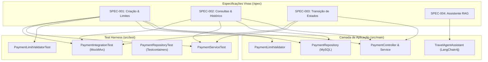

# 📚 Spec-Driven Development (SDD) — Payment System Specification Hub

> **Projeto:** Payment System (Microsserviço de Pagamentos e Assistente RAG em Spring Boot)  
> **Abordagem:** Spec-Driven Development (SDD) — Engenharia Reversa e Especificações Vivas  
> **Nível de Adoção:** Nível 2/3 (Spec-Anchored com Test Harness Integrado)  
> **Referência Metodológica:** [Guia de Aprendizado SDD](file:///home/diegosneves/Github/pessoal/java/payment-system/guia-spec-driven-development-sdd.md)

---

## 🎯 1. Visão Geral do Fluxo Inverso (Reverse SDD)

Este diretório contém a formalização em **Spec-Driven Development (SDD)** do projeto `payment-system`. 

### Por que o "Fluxo Inverso"?
Em projetos convencionais (*Code-Driven*), o software nasce a partir de código ou protótipos, e o conhecimento de regras de negócio fica enterrado em controllers, services e repositórios. 

No **Fluxo Inverso de SDD**, realizamos o resgate e formalização de toda a intenção de negócio, contratos de API, máquinas de estado e critérios de aceitação contidos no código existente, transformando-os em **especificações estruturadas e vivas**.

```
Fluxo Tradicional (Code-Driven):
Requisito Informal ───> [ Código Java ] ───> Documentação Defasada

Fluxo Inverso (Engenharia Reversa para SDD):
[ Código Java Pronto ] ───> [ Análise de Intenção & Regras ] ───> [ Specs Estruturadas (/spec) ]
                                                                             │
Como o projeto teria nascido sob SDD:                                        │
Intenção / PRD ───> [ Spec Viva (/spec) ] ───> IA + Scaffolding ───> Test Harness (Validação)
```

Se este projeto tivesse sido construído do zero sob a ótica SDD:
1. O Product Manager / Arquiteto teria escrito primeiro os arquivos em `spec/`.
2. A IA teria gerado os DTOs, entidades JPA, interfaces de repositório e serviços de negócio diretamente das especificações.
3. O **Test Harness** (Testcontainers, MockMvc, Mockito) teria sido gerado a partir dos critérios de aceitação (*Given-When-Then*).
4. O código só seria considerado concluído após 100% de conformidade com as especificações.

---

## 📂 2. Estrutura das Especificações (`/spec`)

| Identificador | Título do Módulo / Feature | Status | Artefatos de Código Associados |
| :--- | :--- | :--- | :--- |
| **[SPEC-001](file:///home/diegosneves/Github/pessoal/java/payment-system/spec/SPEC-001-payment-creation-and-limits.md)** | Criação de Pagamento e Controle de Limite Diário | `Implemented` | `PaymentController`, `PaymentService`, `PaymentLimitValidator`, `PaymentRepository` |
| **[SPEC-002](file:///home/diegosneves/Github/pessoal/java/payment-system/spec/SPEC-002-payment-queries-and-history.md)** | Consultas, Listagens e Histórico de Pagador | `Implemented` | `PaymentController`, `PaymentService`, `PaymentRepository` |
| **[SPEC-003](file:///home/diegosneves/Github/pessoal/java/payment-system/spec/SPEC-003-payment-status-transition.md)** | Máquina de Estados e Transição de Status | `Implemented` | `PaymentController`, `PaymentService`, `PaymentStatus`, `PaymentConstraintsException` |
| **[SPEC-004](file:///home/diegosneves/Github/pessoal/java/payment-system/spec/SPEC-004-travel-agent-ai-rag.md)** | Assistente Conversacional de Viagens (IA & RAG) | `Implemented` | `TravelAgentController`, `TravelAgentAssistant`, `RagConfiguration`, `contexto-teste.md` |
| **[TEMPLATE](file:///home/diegosneves/Github/pessoal/java/payment-system/spec/TEMPLATE.md)** | Template Padrão para Novas Especificações | `Active` | Modelo de governança para qualquer nova feature |
| **[HARNESS](file:///home/diegosneves/Github/pessoal/java/payment-system/spec/HARNESS.md)** | Guia de Harness Engineering e Validação de Specs | `Active` | Estratégia de testes, CI/CD, Testcontainers e Self-Healing |

---

## 🗺️ 3. Matriz de Rastreabilidade (Spec ⟷ Código ⟷ Testes)

Uma das maiores forças do SDD é a rastreabilidade bidirecional: cada linha de especificação possui um teste e uma classe correspondente.



---

## 🛡️ 4. A Regra de Ouro da Governança SDD

Para manter o projeto saudável e evitar a armadilha do **"Waterfall Automatizado"**:

1. **Spec First / Spec Anchored:** Toda nova regra de negócio, novo endpoint ou alteração de comportamento deve começar com um PR alterando ou criando um arquivo em `/spec`.
2. **Critérios de Aceitação como Testes:** Os cenários *Given-When-Then* descritos nas specs devem ser traduzidos diretamente em métodos de teste no pacote `src/test/java`.
3. **Imutabilidade sem Spec:** Nenhum Pull Request de código deve ser aprovado se modificar comportamentos de negócio sem a atualização concomitante da especificação correspondente.
