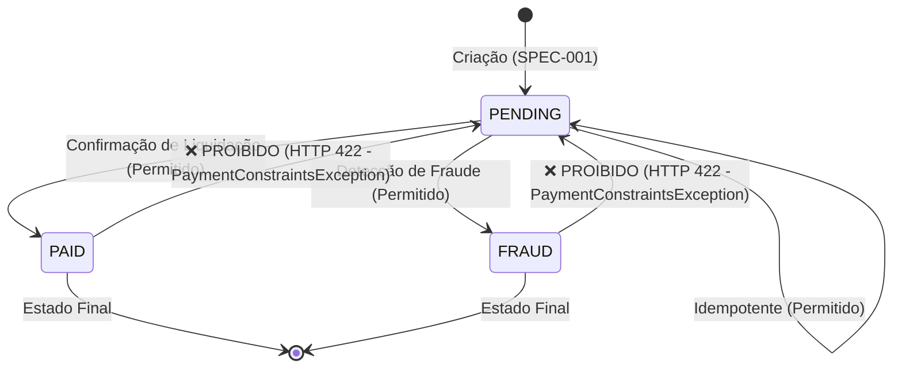

# SPEC-003: Máquina de Estados e Transição de Status de Pagamento

- **Versão:** 1.0.0
- **Squad / Domínio:** Core Banking / Payments
- **Status:** Implemented
- **Data de Criação:** 2026-10-12
- **Última Atualização:** 2026-10-12
- **Autores / Responsáveis:** Diego Neves

---

## 1. Intenção & Contexto de Negócio

### 1.1 Objetivo
Controlar o ciclo de vida e a integridade transacional de pagamentos através de uma máquina de estados finitos (*State Machine*), assegurando que um pagamento finalizado (como pago ou marcado por fraude) nunca sofra regressão indevida para o estado pendente.

### 1.2 Problema Resolvido
Em sistemas financeiros, a transição inconsistente de status (ex: reabrir um pagamento já liquidado como pendente) gera vulnerabilidades críticas de negócio, duplicidade de cobrança e quebra de conciliação contábil. Esta especificação formaliza as regras de transição permitidas e proíbe terminantemente transições regressivas.

### 1.3 Escopo & Limites
- **Dentro do escopo:**
  - Atualização do status de um pagamento via endpoint REST `PUT`.
  - Validação de payload não-nulo e existência prévia do pagamento.
  - Bloqueio de regressão de status (`PAID` -> `PENDING` / `FRAUD` -> `PENDING`).
- **Fora do escopo:**
  - Estornos parciais (Chargeback parcial / Refund).
  - Webhooks de notificação push externa.

---

## 2. Contratos Técnicos

### 2.1 Interface REST
- **Método HTTP:** `PUT`
- **Rota:** `/api/payments/{paymentId}/status`
- **Parâmetros:** `paymentId` (Path Variable, Long, obrigatório)
- **Consumes:** `application/json`
- **Produces:** `application/json`

### 2.2 Contrato de Entrada (Request Body)
```json
{
  "$schema": "http://json-schema.org/draft-07/schema#",
  "type": "object",
  "required": ["status"],
  "properties": {
    "status": {
      "type": "string",
      "enum": ["PENDING", "PAID", "FRAUD"],
      "description": "Novo status pretendido para o pagamento"
    }
  }
}
```

*Representação Java Record correspondente:*
```java
public record UpdatePaymentStatusRequest(
    PaymentStatus status
) {}
```

### 2.3 Contrato de Saída (Sucesso - HTTP 200 OK)
Retorna o objeto `PaymentResponse` com o campo `status` devidamente atualizado.
```json
{
  "id": 1,
  "payerId": "739e5f1e-2459-499d-9cdd-ab59b31c02d9",
  "paymentSource": "PIX",
  "amount": 100.00,
  "status": "PAID",
  "createdAt": "2026-10-12T17:30:00"
}
```

### 2.4 Respostas de Erro Padronizadas (`ApiError`)
| HTTP Status | Causa | Mensagem / Formato |
| :--- | :--- | :--- |
| `400 Bad Request` | Payload nulo ou campo `status` nulo | `{"message": "Payment status must not be null", "errors": []}` |
| `404 Not Found` | `paymentId` não localizado no banco | `{"message": "Payment ID: [ID] is not found", "errors": []}` |
| `422 Unprocessable Entity` | Violação de restrição da máquina de estados (`PaymentConstraintsException`) | `{"message": "Action not allowed for payment with status PAID: PENDING -> PAID", "errors": [...]}` |

---

## 3. Regras de Negócio & Invariantes



- **RN-01 [Obrigatoriedade do Status]:** A requisição não pode conter `status` nulo. Violação gera `PaymentException("Payment status must not be null")` com HTTP 400.
- **RN-02 [Existência Prévia]:** O pagamento deve existir no repositório. Caso inexista, lança `PaymentNotFoundException("Payment ID: %s is not found".formatted(paymentId))` com HTTP 404.
- **RN-03 [Transições Permitidas]:**
  - Um pagamento com status `PENDING` pode evoluir para `PAID`.
  - Um pagamento com status `PENDING` pode evoluir para `FRAUD`.
  - Um pagamento com status `PENDING` pode receber atualização para `PENDING` (operação idempotente).
- **RN-04 [Bloqueio de Regressão de Estado]:**
  - Se o status atual do pagamento for **diferente de `PENDING`** (ex: `PAID` ou `FRAUD`) e houver tentativa de mudar o status para **`PENDING`**, a operação é sumariamente rejeitada.
  - Lança-se `PaymentConstraintsException` com a mensagem:  
    `"Action not allowed for payment with status %s: %s -> %s".formatted(statusAtual, novoStatus, statusAtual)` (HTTP 422 Unprocessable Entity).
- **RN-05 [Persistência Transacional]:** Ao passar pelas validações, o pagamento atualizado deve ser salvo no repositório e o novo estado refletido na resposta.

---

## 4. Critérios de Aceitação (Given-When-Then / BDD)

### Cenário 1: Atualização de PENDING para PAID com sucesso
- **Dado que** existe um pagamento ID `1` com status inicial `PENDING`,
- **Quando** enviar uma requisição `PUT /api/payments/1/status` com corpo `{"status": "PAID"}`,
- **Então** o sistema deve atualizar o registro no banco de dados,
- **E** retornar HTTP 200 OK com o campo `status="PAID"`.

### Cenário 2: Rejeição de tentativa de regressão de PAID para PENDING
- **Dado que** o pagamento ID `3` já se encontra com status `PAID`,
- **Quando** enviar uma requisição `PUT /api/payments/3/status` com corpo `{"status": "PENDING"}`,
- **Então** a operação deve ser bloqueada,
- **E** retornar HTTP 422 Unprocessable Entity com `PaymentConstraintsException`,
- **E** a mensagem deve indicar `"Action not allowed for payment with status PAID: PENDING -> PAID"`.

### Cenário 3: Rejeição de payload com status nulo
- **Dado que** a requisição informa um corpo vazio ou `{"status": null}`,
- **Quando** acionar o endpoint `PUT /api/payments/1/status`,
- **Então** o sistema deve retornar HTTP 400 Bad Request,
- **E** a mensagem deve ser `"Payment status must not be null"`.

### Cenário 4: Tentativa de atualização de pagamento inexistente
- **Dado que** o ID `999` não existe no banco,
- **Quando** tentar atualizar o status via `PUT /api/payments/999/status`,
- **Então** o sistema deve retornar HTTP 404 Not Found com `"Payment ID: 999 is not found"`.

### Cenário 5: Atualização idempotente de PENDING para PENDING
- **Dado que** o pagamento ID `1` está com status `PENDING`,
- **Quando** enviar `PUT /api/payments/1/status` com `{"status": "PENDING"}`,
- **Então** a requisição deve ser aceita com HTTP 200 OK mantendo `PENDING`.

---

## 5. Rastreabilidade com Código e Test Harness

### Código de Produção
- `br.com.neves.paymentsystem.controllers.PaymentController#updatePaymentStatus`
- `br.com.neves.paymentsystem.services.PaymentService#updatePaymentStatusToPaid`
- `br.com.neves.paymentsystem.services.PaymentService#changePaymentStatus`
- `br.com.neves.paymentsystem.services.PaymentService#validatePaymentStatusChange`
- `br.com.neves.paymentsystem.services.PaymentService#validatePaymentStatusFromUpdatePaymentStatusRequest`
- `br.com.neves.paymentsystem.exceptions.PaymentConstraintsException`

### Testes Automatizados (Harness de Validação)
- `PaymentServiceTest#shouldUpdatePaymentStatusToPaidWhenCurrentPaymentStatusIsPending`: Teste de transição `PENDING` -> `PAID`.
- `PaymentServiceTest#shouldUpdatePaymentStatusToPendingWhenCurrentPaymentStatusIsPending`: Teste de idempotência `PENDING` -> `PENDING`.
- `PaymentServiceTest#shouldThrowPaymentConstraintsExceptionWhenReceivePendingPaymentStatusForChangeAnotherStatus`: Teste de violação de invariante (`PAID` -> `PENDING`).
- `PaymentServiceTest#shouldThrowPaymentExceptionWhenReceivePaymentStatusNull`: Teste de payload nulo.
- `PaymentServiceTest#shouldThrowPaymentNotFoundExceptionWhenCantFindPaymentId`: Teste de ID inexistente.
- `PaymentIntegrationTest`: Teste de integração end-to-end de atualização de status e validação de código HTTP 422.
